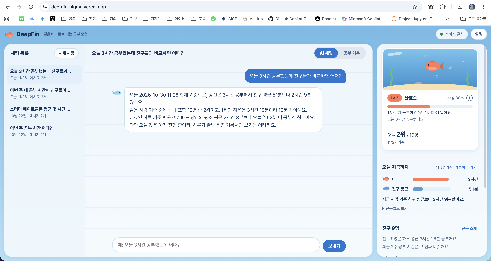
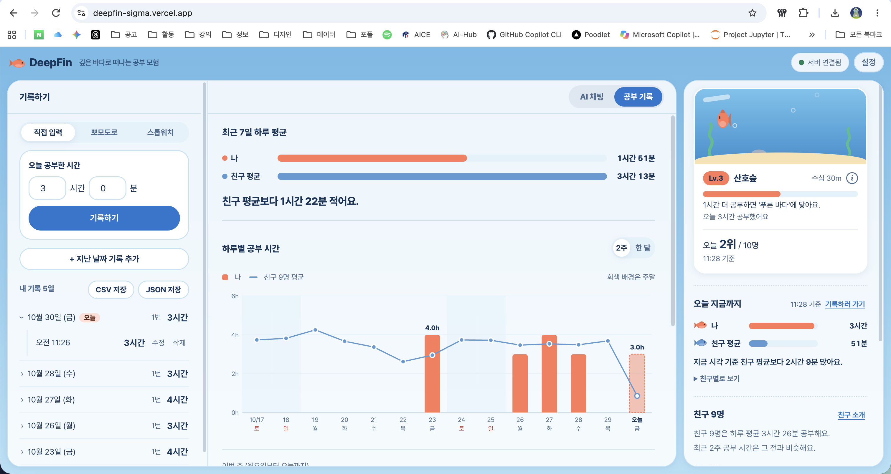
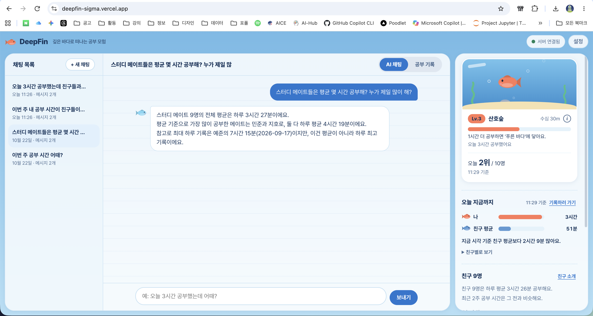

# DeepFin - 깊은 바다로 떠나는 공부 모험

내 공부 시간을 가상 친구 9명과 비교하고, 그 기록을 바탕으로 공부 습관 질문에 답해 주는 AI 채팅 서비스입니다.
오늘 공부한 시간만큼 어항 속 물고기가 깊이 내려가고, 매일 자정에 얕은 물로 돌아옵니다.

> 친구 9명과 그들의 기록은 모두 **가상 데이터**입니다. 실제 사람이나 실제 통계가 아니며, 내 공부량을 가늠하는 기준점으로만 씁니다.

## 배포 주소

| 구분 | 주소 |
| --- | --- |
| 프론트엔드 (Vercel) | https://deepfin-sigma.vercel.app |
| 백엔드 (Render) | https://deepfin-api.onrender.com |
| API 문서 (Swagger) | https://deepfin-api.onrender.com/docs |

> **처음 접속이 느릴 수 있어요.** 백엔드가 무료 플랜이라 한동안 쓰지 않으면 잠들어요. 첫 요청은 깨어나는 데 최대 1분쯤 걸립니다. 화면 위쪽에 "서버 확인 중"이 보이는 동안 기다려 주세요.

## 스크린샷

| 데이터 요약이 반영된 AI 채팅 | 데이터 관리(CRUD) | 저장된 대화 불러오기 |
| --- | --- | --- |
|  |  |  |

## 주요 기능

- **데이터 기반 AI 채팅**: 저장된 학습 시간 요약(기간, 개수, 평균/최대/최소, 최근 추세, 친구와의 비교)을 시스템 프롬프트에 넣어, 내 기록에 맞춘 답을 줍니다.
- **데이터 관리(CRUD)**: 하루에 여러 번 공부 기록을 추가하고, 건별로 수정·삭제합니다. 기록은 날짜별로 접고 펼쳐 볼 수 있습니다.
- **측정 도구**: 직접 입력, 뽀모도로, 스톱워치. 일시정지로 잠깐 멈추고, 완료하면 그때까지의 시간이 바로 오늘 기록에 더해집니다.
- **어항과 순위**: 오늘 공부 시간으로 수심과 레벨, 친구들 사이 순위가 정해집니다.
- **한눈에 보기**: 최근 7일 평균 비교, 하루별 그래프, 이번 주와 연속 공부일.
- **대화 저장**: 대화가 Firestore에 저장되고, 목록에서 다시 불러올 수 있습니다.
- **내보내기**: 내 기록을 CSV 또는 JSON으로 저장합니다.

## 기술 스택

- 백엔드: Python 3.12, FastAPI, Pydantic, firebase-admin(Firestore)
- AI: OpenAI 호환 API (코디세이 콘솔)
- 프론트엔드: 순수 HTML / CSS / JavaScript (프레임워크 없음)
- 배포: Render(백엔드), Vercel(프론트엔드)

## 구조

```
main.py                 앱 진입점 (CORS, 라우터 연결)
app/
  routers/              HTTP 요청 처리 (data, conversations, chat, friends, health)
  schemas/              요청/응답 모양과 검증 (Pydantic)
  services/             비즈니스 로직 (요약 계산, Firestore, AI 호출, 캐시)
frontend/               화면 (index.html, css, js)
scripts/make-config.js  Vercel 빌드에서 API 주소 설정 파일을 만든다
```

## 데이터

- Firestore `data` 컬렉션. 문서 ID는 `{이름}_{날짜}`이고 하루에 한 문서입니다.
- 필드: `person`, `date`, `value`(그날 공부한 분 합계), `memo`, `entries`(그날 추가한 기록 목록: `id`, `minutes`, `at`, `memo`).
- 친구 9명의 기록은 `app/services/persona.py`의 규칙으로 만든 가상 데이터이며, 끝난 날짜가 서버 실행 시 자동으로 채워집니다. 오늘 날짜는 저장하지 않고 시각에 맞춰 계산합니다.
- 대화는 `conversations` 컬렉션에 저장됩니다.

## API

| 메서드 | 경로 | 설명 |
| --- | --- | --- |
| POST | `/api/data` | 기록 추가 (같은 날이면 그날에 한 건 더 쌓임) |
| GET | `/api/data` | 기록 목록 (`person`, `limit`) |
| PUT | `/api/data/{id}` | 하루 기록 수정 |
| DELETE | `/api/data/{id}` | 하루 기록 삭제 |
| PUT / DELETE | `/api/data/{id}/entries/{entry_id}` | 하루 안의 기록 한 건 수정/삭제 |
| GET | `/api/data/summary` | 데이터 요약 (`include_prompt=true`면 프롬프트용 글 포함) |
| GET | `/api/friends` | 가상 친구 소개 |
| GET/POST/DELETE | `/api/conversations` | 대화 목록/생성/삭제 |
| POST | `/api/chat` | AI 채팅 (요약을 시스템 프롬프트에 주입) |

전체 목록과 직접 호출은 `/docs`(Swagger)에서 할 수 있습니다.

## 로컬 실행

1. 가상환경과 패키지

```bash
python3 -m venv .venv
source .venv/bin/activate
pip install -r requirements.txt
```

2. `.env.example`을 복사해 `.env`를 만들고 값을 채웁니다. (`.env`는 커밋되지 않습니다)

3. 백엔드 실행

```bash
uvicorn main:app --reload
```

4. 프론트엔드 실행 (다른 터미널)

```bash
cd frontend
python3 -m http.server 5500
```

5. 브라우저에서 http://localhost:5500 을 엽니다. API 문서는 http://localhost:8000/docs 입니다.

## 환경 변수

| 이름 | 설명 |
| --- | --- |
| `OPENAI_API_KEY` | AI API 키 |
| `OPENAI_BASE_URL` | 코디세이 콘솔이 안내하는 base_url |
| `OPENAI_MODEL` | 사용할 모델 이름 |
| `FIREBASE_SERVICE_ACCOUNT_PATH` | 로컬: 서비스 계정 JSON 파일 경로 (프로젝트 폴더 밖에 보관) |
| `FIREBASE_SERVICE_ACCOUNT_JSON` | 배포: 서비스 계정 JSON 내용 전체 (한 줄) |
| `ALLOWED_ORIGINS` | CORS 허용 주소 목록 (쉼표로 구분). 배포 후 Vercel 주소를 넣습니다 |
| `API_BASE_URL` | 프론트가 호출할 백엔드 주소. Vercel 환경변수로 넣으면 빌드 때 `config.js`가 만들어집니다 |
| `CHAT_MAX_TOKENS`, `CHAT_TIMEOUT_SECONDS`, `CHAT_RATE_LIMIT_PER_MIN`, `CHAT_DAILY_LIMIT` | 선택. 채팅 과금 보호 장치(기본값 있음) |

키와 서비스 계정 파일은 코드에 넣지 않고 환경 변수로만 읽습니다.

## 배포

**백엔드 (Render, Web Service)**

- Build Command: `pip install -r requirements.txt`
- Start Command: `uvicorn main:app --host 0.0.0.0 --port $PORT`
- 환경 변수: 위 표의 `OPENAI_*`, `FIREBASE_SERVICE_ACCOUNT_JSON`, `ALLOWED_ORIGINS`

**프론트엔드 (Vercel)**

- Root Directory는 저장소 최상위를 그대로 두면 `vercel.json`이 빌드 명령과 출력 폴더(`frontend`)를 지정합니다.
- 환경 변수: `API_BASE_URL` = Render 백엔드 주소

## 설계 메모와 한계

- 요약과 목록은 서버 메모리에 30분 저장하고, 기록이 바뀌면 바로 비웁니다. 서버가 재시작되면 메모는 사라집니다.
- 로그인이 없어 한 사람이 쓰는 것을 가정합니다. 누구나 같은 데이터에 접근할 수 있습니다.
- 채팅 횟수 제한은 서버 메모리에서 세므로 재시작하면 초기화됩니다.
- 친구 순위는 같은 시각까지의 공부 시간 기준이라 하루 동안 값이 계속 바뀝니다.
